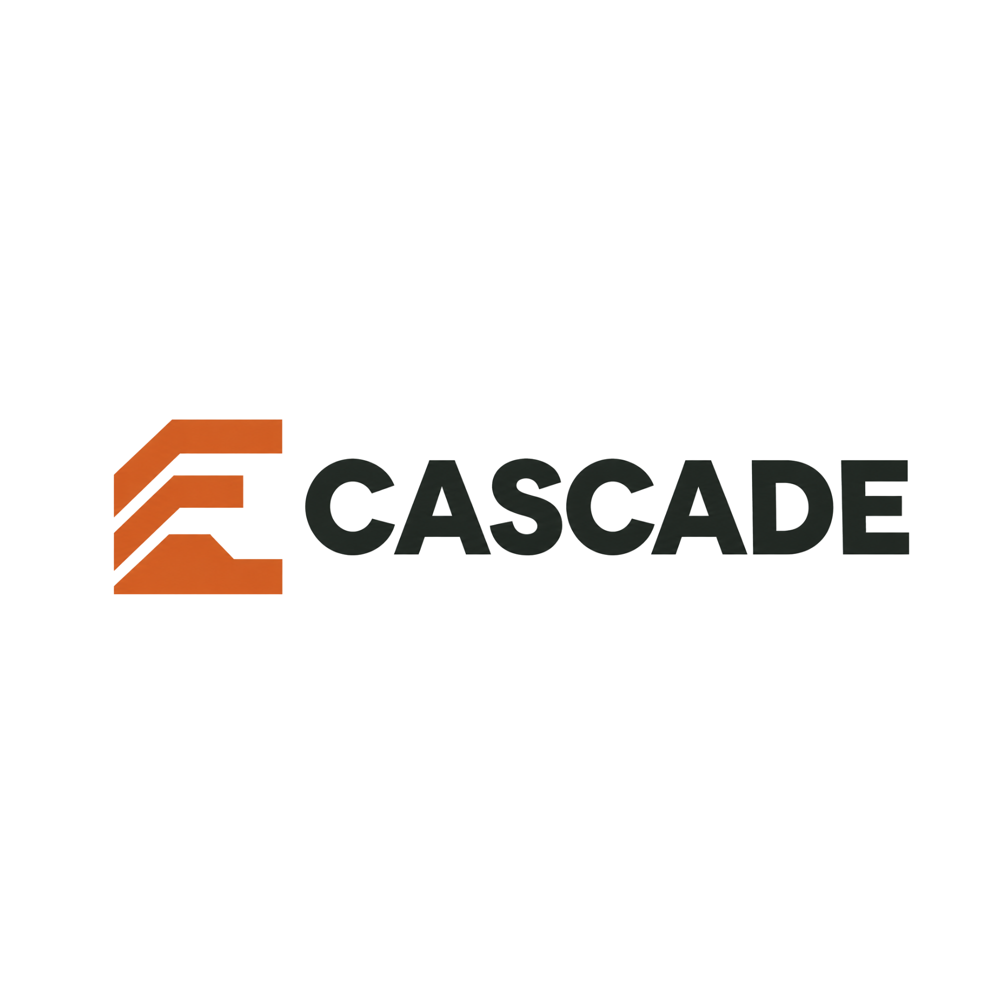

<p align="center">
  
</p>

# Cascade — Autonomous Legacy & Physical Infrastructure Operations Center

**Cascade** is an autonomous agentic platform for commercial real estate and data center operations that bridges **legacy mainframe software** (COBOL, JCL, SQL, lease contracts) and **live physical building telemetry** (chillers, UPS panels, CRAH units, SLA contracts) in a single deterministic dependency graph.

---

## Track Alignment & Judging Guide

### 1. NVIDIA Track — Dual-Model Nemotron Agentic Architecture
- **High-Level Planner & Code Assembler (`nvidia/llama-3.3-nemotron-super-49b-v1.5` / `nemotron-3-super-120b`)**:
  - Ingests multi-point telemetry anomalies, plans structured tool-calling sequences (`query_graph`, `simulate_failure`, `draft_tenant_notice`, `schedule_maintenance`, `failover_to_backup`), handles tool failures with automatic replanning (`replan_reason`), and assembles modern TypeScript replacements from legacy COBOL.
- **Fast Entity & Dependency Extractor (`nvidia/nemotron-3-nano-30b-a3b`)**:
  - Leverages the **131k context window** to ingest full COBOL programs (`LEASEBIL.cbl`, `CAMCALC.cbl`, `ESCINDEX.cbl`), copybooks (`TENANT.cpy`), JCL batch flows (`NIGHTLY.jcl`), and multi-page lease amendments simultaneously without lossy chunking.
- **Strict Separation of Reasoning vs. Deterministic Math**:
  - Every LLM-extracted edge starts as `verified: false` (dashed line, excluded from dollar totals) until confirmed by deterministic AST/regex parsers (`server/src/engines/ast-parser.ts`).
  - All financial calculations, $k$-of-$n$ cascade propagation (`server/src/engines/cascade.ts`), and `BigInt` fixed-point billing (`server/src/engines/leasebil.ts`) run in deterministic code.
- **Rate-Limit Resilience**:
  - Token-bucket limiter + deterministic **Replay Mode** (`0.45x` step timing, zero external API calls) so live demos never stall on API rate limits.

### 2. 8090 Track — 5-Stage Software Factory (`Refine → Map → Plan → Assemble → Validate`)
- **Stage 1 (Refine)**: Extracts formal business rules from `LEASEBIL.cbl` and `CAMCALC.cbl` (including `COMP-3` packed decimals, Y2K pivot windowing, `ROUNDED` vs. unrounded truncation, and `COOLFLAG.DAT` SLA credit triggers).
- **Stage 2 (Map)**: Builds the cross-file dependency graph and benchmarks extraction accuracy against planted ground truth and decoy comments (`Precision / Recall / F1` in `/accuracy`), plus real-world scale validation on **AWS Mainframe Modernization CardDemo** (**20,650 lines** of COBOL/copybooks/JCL, **224 nodes**, **732 edges**).
- **Stage 3 (Plan)**: Produces a step-by-step migration plan separating 1:1 behavioral parity from contract bug remediation.
- **Stage 4 (Assemble)**: Generates [`server/src/engines/leasebil.ts`](server/src/engines/leasebil.ts) using exact `BigInt` fixed-point arithmetic.
- **Stage 5 (Validate)**: Runs **47 golden test cases** captured from the real **GnuCOBOL 3.1.2** compiler (`/parity`):
  - **Strict Legacy Parity Mode**: Passes **47 / 47** cases byte-for-byte (compared to only 11 / 47 for a naive IEEE-754 floating-point port).
  - **Patched Contract Mode**: Remediates Findings **F-1** and **F-2** and highlights the exact invoice dollar adjustments case by case.

### 3. CBRE Track — Physical-to-Financial Cascade & Commercial Lease Audit
- **Unified Physical + Software Dependency Graph (`/intelligence`)**:
  - Connects mechanical cooling (`CH-1`, `CH-2`, `CH-3` → `cooling_loop` 2-of-3 redundancy) and electrical power (`UPS-A`, `UPS-B`) through `Data hall 200` (`Acme Cloud SLA`, \$70,000 exposure) and into the nightly COBOL billing batch (`COOLFLAG.DAT` → `LEASEBIL.cbl` → `Tenant billing`).
  - Includes an **Interactive Custom Cascade Sandbox** where operators can fail/restore any combination of equipment and watch downstream $k$-of-$n$ redundancy degrade, fail, and recover in real time.
- **Real-World Telemetry Validation (`/accuracy`)**:
  - Validated against **175,109 building-hours** across 10 commercial buildings from the **Building Data Genome Project 2 (BDG2)** dataset, separating true mechanical threshold/trend alerts from stale sensor faults.
- **Automated Lease-vs-Code Audit (`/findings`)**:
  - **F-1 (\$6,970/yr overbill)**: `LEASEBIL.cbl:206` hardcodes `WS-BASE-YEAR = 2019`, overriding Northwind Retail Amendment #2 §3 (Base Year 2021).
  - **F-2 (\$6,055/yr overcharge)**: `CAMCALC.cbl:39` divides CAM pro-rata share by occupied SF (`403,750`) instead of total rentable SF (`425,000`), violating Master Lease §4.2.
  - **F-7 (\$1M invoice wrap)**: `PIC S9(5)V99 COMP-3` silently truncates the million-dollar digit on adjustments without `ON SIZE ERROR`.
- **Human Approval Gate & Real Action Execution (`/actions`)**:
  - No external side-effects execute without operator approval in the notification bell drawer.
  - Approved notifications and emergency maintenance schedules send real emails + RFC 5545 `.ics` calendar invites via **Resend** and log verifiable receipts in the audit log.

---

## Quickstart

### Prerequisites
- Node.js `>= 20.17`
- Copy `.env.example` to `.env` and fill in your API keys (`NVIDIA_API_KEY`, `RESEND_API_KEY`, `DEMO_EMAIL_TO`, `RETELL_API_KEY`, `RETELL_AGENT_ID`).

### Development (Hot Reload on Ports `5001` & `5173`)
```bash
npm install
npm run dev
```
- Frontend UI: `http://127.0.0.1:5173`
- Backend API & SSE: `http://127.0.0.1:5001/api`

### Single-Port Production / Brev Deployment
Build both workspaces and serve the compiled SPA + API from a single server on port `5001`:
```bash
npm run build
npm start
```
Then open `http://127.0.0.1:5001`.

